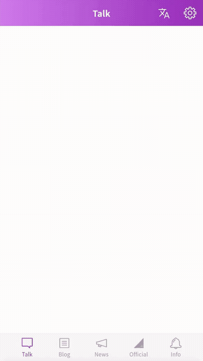
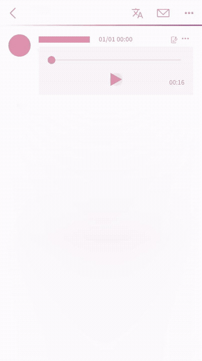
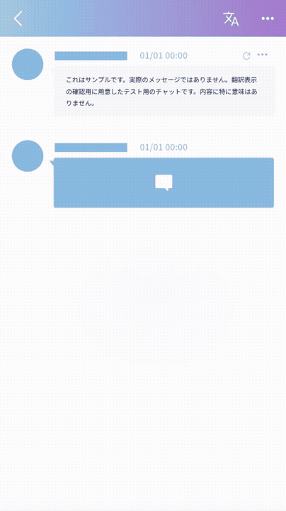

# Sakamichi Mobame Translate

An independent, unofficial, non-commercial userscript that adds per-bubble
translation overlays and voice message transcription to the **櫻坂46メッセージ**,
**乃木坂46メッセージ**, and **日向坂46メッセージ** web apps. It runs in your
browser, has no server of its own, and uses your own AI provider API key.

[About](#about) · [Features](#features) · [Supported apps](#supported-apps) · [Installation](#installation) · [Troubleshooting](#troubleshooting) · [Privacy](#privacy) · [Disclaimer](#disclaimer)

> [!WARNING]
> **Unofficial fan project — use at your own risk.**
> Not affiliated with, authorized by, endorsed by, sponsored by, or officially
> connected to 櫻坂46, 乃木坂46, 日向坂46, Sony Music Solutions Inc., their
> management companies, or any of their affiliates. This is an independent,
> personal, non-commercial project. You are responsible for your own use of the
> script and for complying with each app's terms.
> Read the [full notices](#disclaimer) before installing.

  
  
  

Example only: a mockup, not real paid content.

## About

This is a personal fan project, created to help non-Japanese speakers use
the 櫻坂46, 乃木坂46, and 日向坂46 message apps. It adds two things the apps do
not offer: translation of messages and transcription of voice messages, both
shown directly over each message.

**What it is**

- An independent, unofficial, and non-commercial userscript for the apps' web
  versions.
- Free to use, with no ads and no paid features.
- A tool that works within your own logged-in session, on messages you can
  already view.

**What it is not**

- It is not affiliated with, endorsed by, or connected to the apps' operator,
  the groups, or their management companies.
- It does not provide, host, or redistribute any app content.
- It does not call the apps' APIs, crawl message history, or unlock anything
  you cannot already view.

Data handling is described in [Privacy](#privacy), and the full notices are in
the [Disclaimer](#disclaimer).

## Features

- **Text translation**: an overlay positioned directly over each message
  bubble, following scrolling, resizing, and the app's list virtualization.
- **Layered prompts**: translate into any of 47 languages, pick a tone, add
  custom instructions, and choose how your nickname appears in translations.
- **Voice messages**: a transcript and translation appear over the bubble,
  with word-by-word karaoke highlighting that follows the audio.
- **One settings sheet for all three apps**: provider, model, API keys, and
  style preferences are shared. Translation and voice caches are kept
  separately per app.
- **Local cache and rate limiting**: up to 1,500 translation entries and 500
  voice entries are remembered per app, so a message is not sent to your
  provider again unless you change your translation settings or refresh it.
  Per-provider rate limiting with automatic backoff helps you stay within your
  provider's limits.

## Supported apps

| App | Official name | Web address | Official terms |
|---|---|---|---|
| Nogizaka46 | 乃木坂46メッセージ | `https://message.nogizaka46.com/` | [Terms of Service](https://contact.nogizaka46.com/s/n46app/page/app_terms) |
| Sakurazaka46 | 櫻坂46メッセージ | `https://message.sakurazaka46.com/` | [Terms of Service](https://sakurazaka46.com/s/s46app/page/app_terms) |
| Hinatazaka46 | 日向坂46メッセージ | `https://message.hinatazaka46.com/` | [Terms of Service](https://www.hinatazaka46.com/s/h46app/page/app_terms) |

The script identifies the app from the hostname and stays inactive on every
other site.

## Requirements

- An active account with a subscription to at least one supported app.
- A desktop browser (Chrome, Edge, Firefox, or Opera) with a userscript
  manager — set up in step 1 of [Installation](#installation).
- An API key for text translation, from any of the providers below:

  | Provider | Get a key |
  |---|---|
  | Gemini (Google) | https://aistudio.google.com/app/apikey |
  | Groq | https://console.groq.com/keys |
  | Cerebras | https://cloud.cerebras.ai/ |
  | OpenRouter | https://openrouter.ai/keys |
  | DeepSeek | https://platform.deepseek.com/api_keys |
  | OpenAI | https://platform.openai.com/api-keys |
  | Anthropic (Claude) | https://console.anthropic.com/settings/keys |

- Voice transcription is available with **Gemini, Groq, or OpenAI**.
- Free tiers are available: **Gemini, Groq, and OpenRouter** all issue keys
  at no cost, and Groq's free plan includes voice transcription, so you can
  run the whole flow without paying anything. Free tiers are rate-limited and
  carry their own data terms (see the [Disclaimer](#disclaimer)).
- Usage is billed by your provider, not by this project.

## Installation

1. Install a userscript manager — a small extension that runs user scripts on
   the pages you choose:

   | Browser | Userscript manager |
   |---|---|
   | Chrome | [Tampermonkey](https://chrome.google.com/webstore/detail/tampermonkey/dhdgffkkebhmkfjojejmpbldmpobfkfo) or [Violentmonkey](https://chrome.google.com/webstore/detail/violent-monkey/jinjaccalgkegednnccohejagnlnfdag) |
   | Edge | [Tampermonkey](https://microsoftedge.microsoft.com/addons/detail/tampermonkey/iikmkjmpaadaobahmlepeloendndfphd) |
   | Firefox | [Tampermonkey](https://addons.mozilla.org/firefox/addon/tampermonkey/) or [Violentmonkey](https://addons.mozilla.org/firefox/addon/violentmonkey/) |
   | Opera | [Tampermonkey](https://addons.opera.com/extensions/details/tampermonkey-beta/) or [Violentmonkey](https://chrome.google.com/webstore/detail/violent-monkey/jinjaccalgkegednnccohejagnlnfdag) |

2. Install the script:

   
   

   - **Greasy Fork** — open the
     [script page](https://greasyfork.org/en/scripts/601914-sakamichi-mobame-translate)
     and click **Install**.
   - **GitHub Releases** — open `sakamichi-mobame-translate.user.js` from the
     [latest release](https://github.com/zeem12/sakamichi-mobame-translate/releases/latest);
     your userscript manager shows an install page, where you click **Install**.

## Getting started

1. Open a supported app in the same browser and sign in.
2. Open any member chat.
3. Click the
    in
   the header to open the settings sheet: choose a provider, paste your API
   key, pick a model, and use the connection test.
4. Turn on the **Translate** switch.

## Troubleshooting

**If a voice message still plays normally, but its transcript can no longer
be fetched**, the cause is an expired link: each app serves its voice
messages through links that expire after a while. Once a link has expired,
the script can no longer fetch that message's audio for transcription.
Playback can still look completely normal, because your browser may keep
serving the audio from its own cache — which is what hides the problem.

The fix is a step the script cannot do for you: empty the browser's cache,
then reload the page and let the app fetch a fresh link.

1. Open your browser's developer tools (press <kbd>F12</kbd>, or right-click
   the page and choose Inspect) and switch to the **Network** tab.
2. Right-click any of the requests listed there and choose **Clear browser
   cache**. In Firefox, press <kbd>Ctrl</kbd>+<kbd>F5</kbd> (Windows/Linux)
   or <kbd>Cmd</kbd>+<kbd>Shift</kbd>+<kbd>R</kbd> (macOS) instead — a
   reload that bypasses the cache.
3. Reload the page, then play the voice message once more. The app fetches
   a fresh link, and the transcript — and its translation — load as usual.

Your saved transcripts and translations are not affected. If a transcript
still does not load, play the voice message again.

## Updates and removal

**Updating.** Your userscript manager checks for updates on its own schedule,
using the script's update address, and you can also check manually from the
manager's dashboard. Changes in each release are listed in the
[changelog](CHANGELOG.md).

**Removing.** Remove the script from your userscript manager's dashboard. A
manager may keep a removed script's stored data, so if you want your settings,
API keys, translations, and transcripts deleted, use **Reset everything**
first (see [Privacy](#privacy)).

## Privacy

The script runs in your browser: the project has no server, and no data ever
reaches the author. The project collects nothing — no telemetry, no analytics,
no accounts, no third-party reporting — and no account identifiers, session
tokens, authentication headers, or network history are stored.

> [!IMPORTANT]
> **Keep your API key private.** Treat it like a password: never share it,
> and never post it in screenshots or bug reports.

**Content that leaves your device** — only while translating or transcribing:

| Destination | What is sent |
|---|---|
| Your translation provider (LLM) | Message text already on your screen, your style settings (language, tone, instructions), and your nickname. Your API key authenticates each request, including model lists and connection tests |
| Your transcription provider (STT) | The audio of the voice message being transcribed — the same file the app plays, from the app's own media CDN. Your API key authenticates the request |

What a provider does with this content afterward is governed by its own terms.

**Stored on your device** — in your userscript manager's storage, never in
the app's:

| Data | Limit |
|---|---|
| Preferences (language, provider, model, tone, instructions) | Shared across apps |
| API keys | Shared across apps; kept by your userscript manager, not encrypted by the script |
| Translation cache | 1,500 entries per app |
| Voice transcripts and translations | 500 entries per app |
| Voice file map (maps a chat identifier and a message timestamp to an audio file name) | 300 entries per app |
| Audio bytes | **Never written to storage.** Memory only, gone when the tab closes |

**Read from the app's storage.** One value only: your nickname, kept in the
app's own profile (`flutter.PROFILE_NAME_KEY` in its localStorage; set by you
in the app). The script uses it to keep your nickname — already part of the
message text — from being translated or altered, and to display it the way you
set it in the **Nickname** option. It is sent only to your translation
provider, inside text translation requests and only while translating; it is
re-read on each page load, kept in memory, and never included in voice
requests.

**Deleting your data.** In **Data & privacy**, **Delete all data** removes
saved translations, voice transcripts, and voice file maps for all supported
apps while keeping your settings, and **Reset everything** also deletes your
API keys and all settings. Both require a second confirmation before doing
anything.

**How the script works with the apps.** The script runs inside your own
logged-in browser session and works only with content the apps present to you.
It does not patch `fetch` or `XMLHttpRequest`, does not call the apps' APIs,
does not crawl message history, and does not write to or delete from the apps'
storage. To transcribe a voice message, it obtains the audio the app plays,
holds it in memory only, and sends it to your transcription provider; the
script never saves it.

## Disclaimer

In this Disclaimer, "the script" means the userscript distributed in this
repository, "the project" means the script together with its repository and
documentation, and "the apps" means the three web apps listed in
[Supported apps](#supported-apps).

**Unofficial project.** The project and its contributors are not affiliated
with, authorized by, endorsed by, sponsored by, or officially connected to
櫻坂46, 乃木坂46, or 日向坂46; Sony Music Solutions Inc., which operates the
apps; Seed & Flower LLC, the management company of 櫻坂46 and 日向坂46;
Nogizaka46 LLC, which is credited as a copyright holder for 乃木坂46メッセージ;
or any of their affiliates. It is an independent, personal, non-commercial
project created by a fan to help non-Japanese speakers use the apps. The
script operates within your own logged-in session, only on messages you can
already view, and adds only what the apps themselves do not offer.

**App terms.** Your use of each app is governed by that app's Terms of Service,
linked in the [Supported apps](#supported-apps) table. The project does not
assess whether any use of the script is consistent with those terms, and you
are solely responsible for reviewing and complying with them.

**Content and copyright.** The project claims no ownership of the text of
messages and the audio of voice messages that the script processes, of the
transcripts and translations made from them, of the apps' design, of member
names, or of anything else accessed through the apps, and it grants no
licenses to any such content. The project does not publish, share, archive, or
collect any of it. Content is processed only at your direction: message text
and voice audio are sent solely to the AI providers you configure, to produce
a translation or transcript for you, and the results are shown only to you and
cached only on your device. You are solely responsible for any copying,
storing, translating, transmitting, or other use of content that results from
your use of the script, and for complying with all applicable laws.

**Third-party services.** Translations and transcripts are produced by the AI
providers you choose. Their quality and accuracy are those providers'
responsibility, not the project's, and AI output can be incorrect. Charges,
usage limits, and data handling — including whether free-tier content may be
used to improve a provider's products — are governed by each provider's own
terms. The project has no relationship with any provider and does not control
what a provider does with the content you send. You are solely responsible for
your API keys and for any charges they incur.

**Trademarks.** "櫻坂46", "乃木坂46", "日向坂46", "櫻坂46メッセージ",
"乃木坂46メッセージ", "日向坂46メッセージ", and related names, marks, and
imagery are the property of their respective owners. They are used here only
to identify the apps the script works with. That use does not imply any
affiliation with, or endorsement by, the trademark holders. The names of AI
providers, userscript managers, and other products mentioned in this document
belong to their respective owners and are used for identification only.

**No warranty and limitation of liability.** The script is provided "AS IS",
without warranty of any kind, express or implied, including the warranties of
merchantability, fitness for a particular purpose, and non-infringement. The
script may stop working at any time, for example when an app changes. To the
fullest extent permitted by applicable law, any risk arising from the use of
the script lies with the user, and the author and contributors accept no
liability for any claims, damages, loss of access to an app or account, or
other consequences arising from the use of, or inability to use, the script.

**Availability.** The project exists only to fill a gap in the apps' features,
and the author is willing to take it down if the official apps provide
equivalent features. As a personal project, it may be modified, suspended, or
withdrawn at any time.

**Acceptance.** By installing or using the script, you accept this Disclaimer
in full. If you do not agree, do not install or use it.

## License

The script's source code in this repository is released under the
[MIT License](LICENSE).

The license covers the source code only. It grants no rights to any app
content, member names, trademarks, or anything processed by the script; all of
those remain with their respective owners. See the [Disclaimer](#disclaimer)
for the full notices.

## Support

This project is free and non-commercial. If you would like to support the
author's open-source work in general:

Bug reports and feature requests are welcome on the
[issue tracker](https://github.com/zeem12/sakamichi-mobame-translate/issues).
When reporting a problem, include your browser, userscript manager, and script
version, and remove API keys and personal information from any screenshots or
logs.
